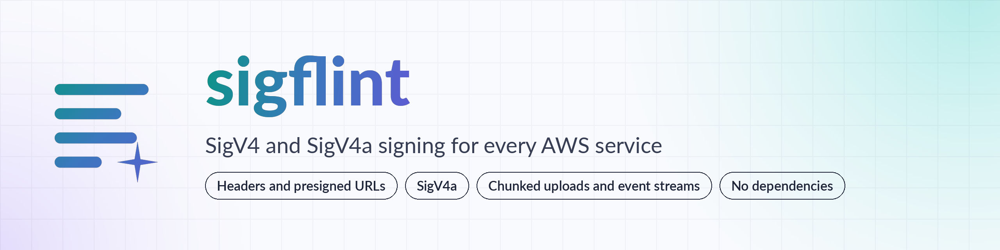

<h1 align="center">
  <picture>
    <source media="(prefers-color-scheme: dark)" srcset="docs/assets/banner-dark.png">
    
  </picture>
</h1>

Fast AWS Signature Version 4 request signing for every AWS service, with no dependencies. It runs on Node.js, Bun, Deno, Cloudflare Workers and browsers.

```js
import { getAuthHeaders } from 'sigflint';

const url = new URL('https://my-bucket.s3.us-east-1.amazonaws.com/photos/cat.jpg');
const headers = await getAuthHeaders(
  { method: 'GET', url, region: 'us-east-1' },
  { accessKeyId: process.env.AWS_ACCESS_KEY_ID, secretAccessKey: process.env.AWS_SECRET_ACCESS_KEY },
);
const response = await fetch(url, { headers });
```

It signs requests with the `Authorization` header or as a presigned URL, for S3 and for any other service (`service: 'dynamodb'`, `'sqs'`, `'execute-api'`, ...), and it also does multi-region signatures (SigV4a), chunked uploads and event streams.

- **Correct.** It returns the same signature as botocore for all 3,360 S3 requests in its test corpus, and for 1,622 requests to other services and 1,600 presigned URLs. SigV4a signatures verify against the AWS CRT's, and chunk and event signatures match the AWS SDK's. See [how it is tested](docs/benchmarks.md#how-it-is-tested).
- **Fast.** 1.3 to 3.7 µs per header or presigned-URL signature on Node and 1.7 to 6.4 µs on Bun. The other libraries take 1.8 to 550 times as long on the requests they sign correctly. See [speed](docs/benchmarks.md#speed).
- **Small, and you pay only for what you import.** Signing headers is 5.7 kB minified, 2.8 kB gzipped; presigned URLs, SigV4a, chunked uploads and event streams each add to a bundle only when imported. Nothing to install with it. See [size](docs/benchmarks.md#size).
- **Everywhere.** One import on Node, Bun, Deno and Cloudflare Workers, with or without `nodejs_compat`. See [runtimes](#runtimes).

## Install

```sh
npm install sigflint
```

Node.js 22.12 or newer (it is an ES module; Node 22.12 can also `require()` it). Bun and Deno need no setup.

## Usage

Sign a request and send the returned headers with it. The `host` header is signed but not returned; your HTTP client sets it from the URL.

```js
import { getAuthHeaders } from 'sigflint';

const credentials = { accessKeyId, secretAccessKey, sessionToken }; // sessionToken is optional

// upload an object: the body is hashed into x-amz-content-sha256
const url = new URL('https://my-bucket.s3.us-east-1.amazonaws.com/notes/today.json');
const body = JSON.stringify({ done: true });
const headers = await getAuthHeaders(
  { method: 'PUT', url, region: 'us-east-1', body, signHeaders: { 'content-type': 'application/json' } },
  credentials,
);
await fetch(url, { method: 'PUT', headers, body });
```

For a large or binary body, skip hashing and send `unsignedPayload: true`. S3 accepts that over HTTPS.

```js
const headers = await getAuthHeaders({ method: 'PUT', url, region, unsignedPayload: true }, credentials);
```

Any S3-compatible service works the same way; pass its region name and URL (`https://us-sea-1.linodeobjects.com/bucket/key`, `http://127.0.0.1:9000/bucket/key`).

More in the [guide](docs/guide.md): [other services](docs/guide.md#other-services), [presigned URLs](docs/guide.md#presigned-urls), [SigV4a](docs/guide.md#sigv4a-multi-region), [chunked uploads](docs/guide.md#chunked-uploads), [event streams](docs/guide.md#event-streams), why to always `await`, and the [full API](docs/guide.md#api).

## Runtimes

Node.js 22.12 and later, Bun, Deno, and Cloudflare Workers with or without `nodejs_compat`; browsers get the same WebCrypto code. Each runtime was checked against botocore's signature for one S3 request. The grid, with the other libraries, is in the [benchmarks](docs/benchmarks.md#runtimes).

## Benchmarks

<picture>
  <source media="(prefers-color-scheme: dark)" srcset="docs/speed-dark.svg">
  
</picture>

Correctness, [speed](docs/benchmarks.md#speed), [memory](docs/benchmarks.md#memory) and [size](docs/benchmarks.md#size), the [test corpora](docs/benchmarks.md#how-it-is-tested) and the [methodology and limits](docs/benchmarks.md#methodology-and-limits) are in [docs/benchmarks.md](docs/benchmarks.md). Every figure there comes from raw results committed in `bench/results/`. The speed and memory figures were measured before the latest hardening changes and are re-run before each release.

## Scope

1.0 signs requests for every AWS service in header form and as presigned URLs, plus SigV4a, chunked uploads and event streams. Not included, and not promised:

- hashing binary request bodies for you: hash them yourself, or use `unsignedPayload`
- an HTTP client, retries, credential providers or region lookup
- anything that is not SigV4 or SigV4a

Open an issue describing the use case if you need one of them.

## Security

See [SECURITY.md](SECURITY.md). sigflint never logs credentials or writes them anywhere; it keeps the last secret key in memory as the key of its signing-key cache.

## Sponsoring

sigflint is built and maintained by one person. If it saves you time, you can
sponsor it monthly or once through
[GitHub Sponsors](https://github.com/sponsors/bompus), or leave a tip on
[Ko-fi](https://ko-fi.com/bompus).

## License

[MIT](LICENSE). `CODE_OF_CONDUCT.md` is the Contributor Covenant under CC BY 4.0; see `THIRD_PARTY_NOTICES.md`.
