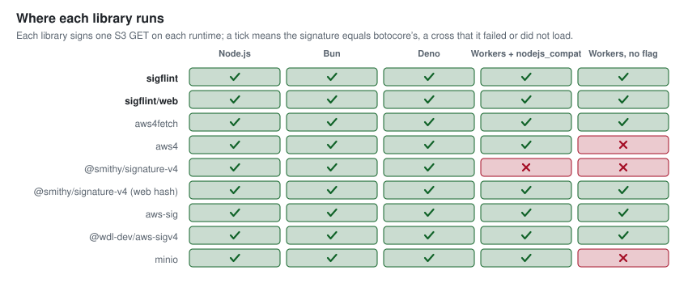
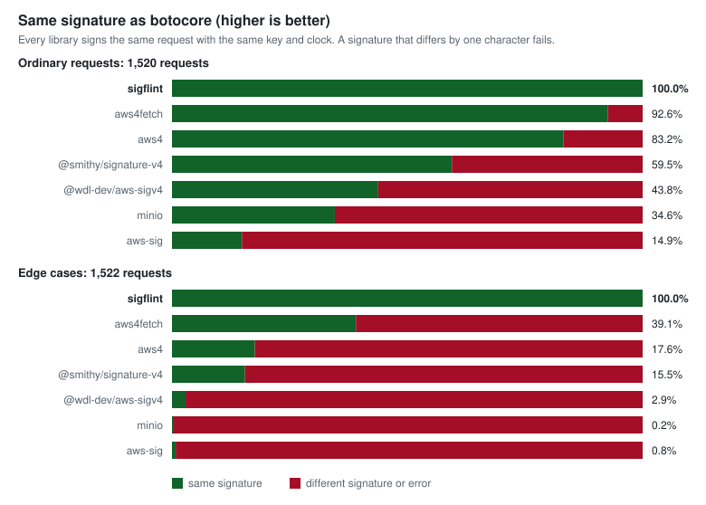
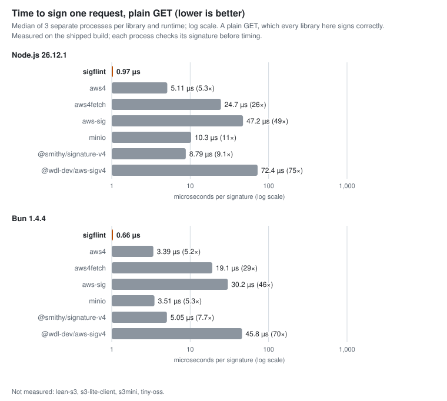
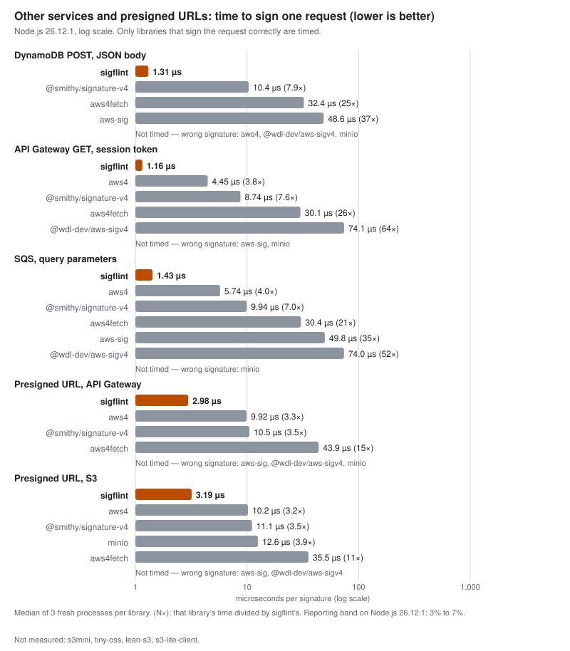
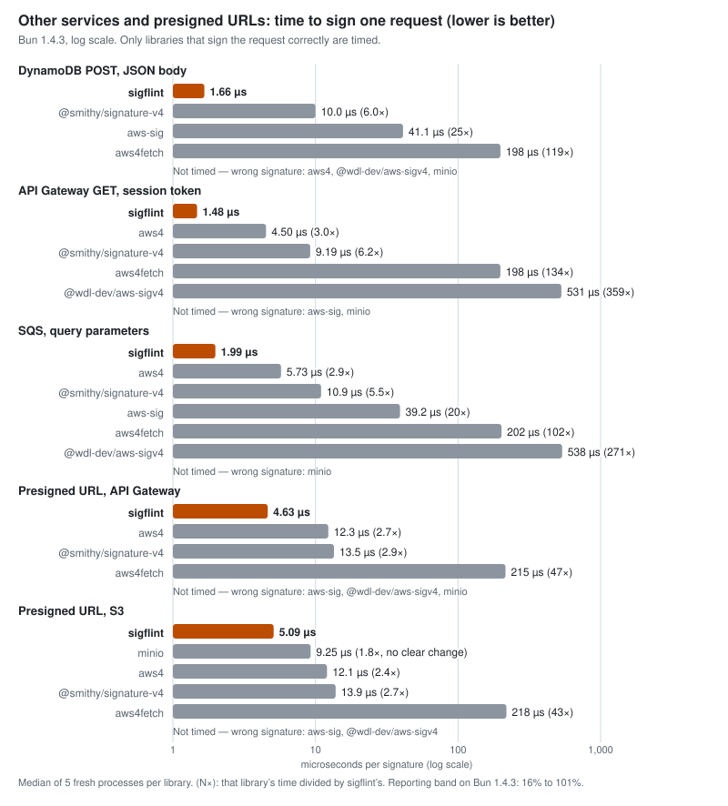
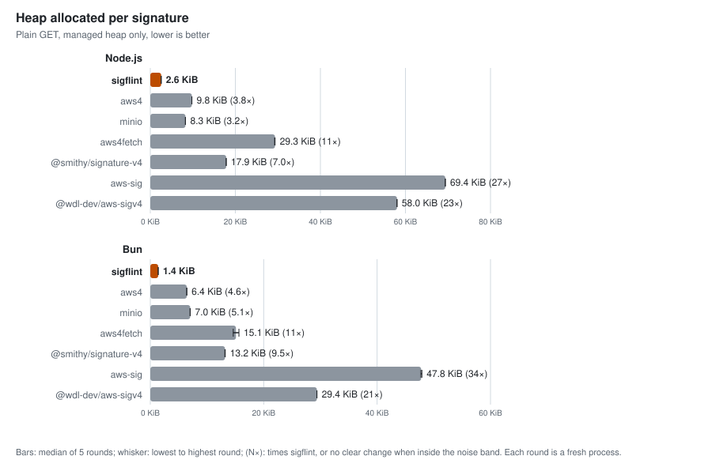
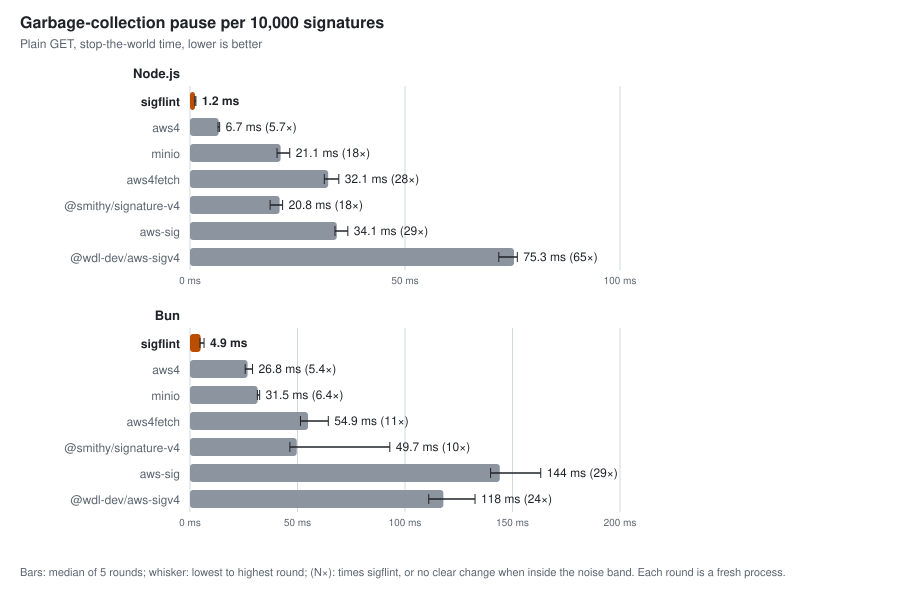
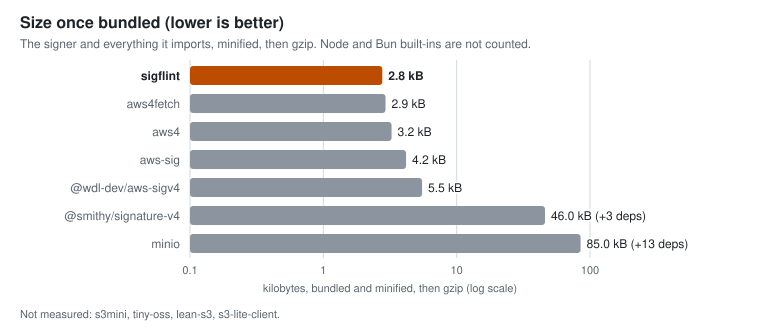
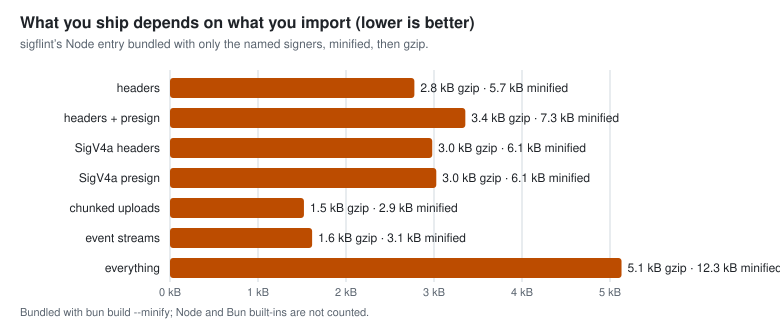

# Benchmarks, tests and limits

How sigflint compares with the other libraries, and how it is checked. The summary is in the [README](../README.md). Library comparisons put sigflint first as the reference, then alternatives alphabetically by displayed name. Correctness rows stay grouped by input method.

The figures below describe sigflint 1.0.3. Speed, memory, import and size were measured on 2026-10-29 on Node.js 26.12.1 and Bun 1.4.4. The current unminified Node and Bun builds match the measured artifact hashes byte for byte. Builds, checks and publishing use Bun 1.4.4.

The speed matrices use three fresh processes per library and runtime; memory and import use five rounds. A/A controls and reporting bands accompany the results. Raw evidence and reproducible protocols are linked under Methodology and limits.

## Runtimes

<!-- BEGIN runtimes -->
<picture>
  <source media="(prefers-color-scheme: dark)" srcset="runtimes-dark.svg">
  
</picture>

| Library | Node.js | Bun | Deno | Workers + nodejs_compat | Workers, no flag |
|---|:-:|:-:|:-:|:-:|:-:|
| **sigflint** | ✓ | ✓ | ✓ | ✓ | ✓ |
| **sigflint/web** | ✓ | ✓ | ✓ | ✓ | ✓ |
| aws4 | ✓ | ✓ | ✓ | ✓ | ✗ |
| aws4fetch | ✓ | ✓ | ✓ | ✓ | ✓ |
| aws-sig | ✓ | ✓ | ✓ | ✓ | ✓ |
| lean-s3 | ✓ | ✓ | ✓ | ✓ | ✗ |
| minio | ✓ | ✓ | ✓ | ✓ | ✗ |
| s3-lite-client | ✓ | ✓ | ✓ | ✓ | ✓ |
| s3mini | ✓ | ✓ | ✓ | ✓ | ✓ |
| @smithy/signature-v4 | ✓ | ✓ | ✓ | ✗ | ✗ |
| @smithy/signature-v4 (web hash) | ✓ | ✓ | ✓ | ✓ | ✓ |
| tiny-oss | ✓ | ✓ | ✓ | ✓ | ✓ |
| @wdl-dev/aws-sigv4 | ✓ | ✓ | ✓ | ✓ | ✓ |

Runtimes: node 26.13.0, bun 1.4.4, deno 2.9.6; Workers run in local workerd through wrangler 4.156.0, workerd 1.20261023.1 (run 2026-10-31; see bench/results/compat-environment.json). ✗ cells: smithy on Workers + nodejs_compat: Hash.bind is not a function; aws4 on Workers, no flag: does not load (bundle error); smithy on Workers, no flag: Hash.bind is not a function; minio on Workers, no flag: does not load (bundle error); lean-s3 on Workers, no flag: does not load (needs a node: module).
<!-- END runtimes -->

Each library signed one S3 GET on each runtime and was checked against botocore's signature. These are signing-path checks, not full client integration tests. “Workers” runs in local workerd through wrangler, not on Cloudflare's network. s3mini and tiny-oss use an unsigned payload, checked against a separately computed botocore reference. tiny-oss and lean-s3 use pinned source signing cores; s3-lite-client uses its locked package core. These three are compiled with Bun, with `node:` imports preserved and no polyfills. Other rows use the same entry points as the correctness comparison. The smithy “web hash” row supplies `@aws-crypto/sha256-js`; its default row supplies the Node hash implementation. Sigflint selects Bun's hasher, Node/Deno's `node:crypto`, or Workers' WebCrypto implementation through package export conditions.

## Correctness

<!-- BEGIN correctness -->
<picture>
  <source media="(prefers-color-scheme: dark)" srcset="correctness-dark.svg">
  
</picture>

Matches against botocore with the same key and clock. Compare libraries within an input method. Counts show matches / supported requests. The common decoded-key column does not apply to serialized-URL inputs. Versions identify the recorded runs.

| Library | Input method | Version | Ordinary matches / supported | Unsupported ordinary | Edge matches / tested | Common decoded-key matches / 578 |
|---|---|---|--:|--:|--:|--:|
| **sigflint** | Serialized URL | 1.0.3 | 1,520 / 1,520 | 0 | 1,838 / 1,838 | Not applicable |
| aws4 | Serialized URL | 1.13.2 | 1,264 / 1,520 | 0 | 424 / 1,838 | Not applicable |
| aws4fetch | Serialized URL | 1.0.20 | 1,408 / 1,520 | 0 | 790 / 1,838 | Not applicable |
| aws-sig | Serialized URL | 2.1.0 | 379 / 1,520 | 0 | 65 / 1,838 | Not applicable |
| minio | Serialized URL | 8.0.7 | 526 / 1,520 | 0 | 40 / 1,838 | Not applicable |
| @smithy/signature-v4 | Serialized URL | 5.7.5 | 904 / 1,520 | 0 | 333 / 1,838 | Not applicable |
| @wdl-dev/aws-sigv4 | Serialized URL | 3.0.4 | 1,174 / 1,520 | 0 | 234 / 1,838 | Not applicable |
| **sigflint** | Decoded key | 1.0.3 | 1,520 / 1,520 | 0 | 1,252 / 1,252 (588 unsupported) | 578 / 578 |
| lean-s3 | Decoded key | 0.11.2 source | 1,293 / 1,520 | 0 | 1,013 / 1,252 (588 unsupported) | 458 / 578 |
| s3-lite-client | Decoded key | 1.0.1 | 1,519 / 1,520 | 0 | 1,252 / 1,252 (588 unsupported) | 578 / 578 |
| s3mini | Decoded key | 1.0.3 | 494 / 578 | 942 | 567 / 645 (1,195 unsupported) | 494 / 578 |
| tiny-oss | Decoded key | 1.2.0 source | 993 / 1,519 | 1 | 513 / 1,252 (588 unsupported) | 316 / 578 |
<!-- END correctness -->

The reference is botocore's S3 signer (`S3SigV4Auth`), run with a fixed clock on the same requests after `conformance/oracle.py` has normalized each path and query, plus the four example signatures printed in the S3 documentation. “Ordinary requests” are valid S3 requests: keys and queries with spaces, unicode, reserved characters, repeated and unsorted parameters. “Edge cases” are requests a strict reading of the specification covers but most libraries do not: a stray `%` or invalid UTF-8 in the URL, a raw `+` in the path, a query pair with an empty name, and headers some libraries never sign (`date`, `range`). The 316 requests with a session token are edge cases too: each library is given the token as it takes one (a credentials option, or the `x-amz-security-token` header that the SDKs send), and sigflint passes all 316. The `aws-sig` and `@wdl-dev/aws-sigv4` adapters are given the request body whatever the method: `aws-sig` hashes the body it is given and ignores the hash header, and `@wdl-dev/aws-sigv4` adds and signs a Content-Type when its body is a string, so it gets bytes. An earlier version dropped the body of GET and HEAD requests for both, which understated them (ordinary matches 226 and 666, now 379 and 1,174). The decoded-key adapters exercise token cases their libraries can express; the older serialized-URL adapters do not wire token support. `npm test` checks the shipped code against the same corpus (`test/corpus.json`, 3,360 requests).

Some of the other libraries expect the caller to canonicalize the path and query first. When the harness hands `@smithy/signature-v4` botocore's canonical path and query, it matches 1,519 of the 1,520 ordinary requests; `minio` matches 1,320 of them (`bench/results/screen-node.json`). The serialized-URL rows above show what each library produces when given the URL as an application has it.

### Input methods and supported requests

The table and chart above include both input methods and the decoded-key edge screen. The serialized-URL screen tests
URL parsing as well as signing. The decoded-key screen ran on Bun 1.4.4 on
2026-10-31 with `bun bench/compat-clients.mjs`. It uses decoded keys and query
pairs from normalized canonical requests, so it does not test arbitrary URL
parsing or complete client operations. Both screens use sigflint 1.0.3. These
are distinct input methods, not directly comparable rankings.

s3mini cannot express the other 942 ordinary requests because its signing path
uses unsigned payloads. tiny-oss's core also accepts a payload hash; its row
uses that option for signed bodies and excludes one header it never signs. The common decoded-key column uses exactly the same 578 requests in each
decoded-key row; it does not apply to serialized-URL rows. sigflint also matches every request in each client's supported subset.
No adapter errors occurred. The seeded corpus contains many unusual characters
and repeated spaces, so these fractions are not production failure rates.
A different signature can also mean a client deliberately signs a different
set of headers, rather than a rejected request.

The adapters invoke each library's own signing code. s3mini's internal `_sign`
receives a key encoded by its own helper. lean-s3 receives its caller-prepared,
sorted query string and uses its own URL builder and header preparation.
Consequently this screen does not test lean-s3's operation-specific query
builders. s3-lite-client receives a decoded key and encoded query, as its caller
supplies them. tiny-oss uses its own path escaping and query canonicalization.
The decoded-key edge screen includes session tokens, the two date/region fixtures
and every representable normalized key/query outside the ordinary set.
Malformed byte sequences cannot be supplied through these decoded UTF-8 APIs and
remain visibly unsupported in every decoded-key row, including Sigflint.
Sigflint can sign those byte sequences through its serialized-URL API.
The raw results record every exclusion reason.
The reference path/query normalization is supplied by this repository, as in
the corpus generation, and is not independently validated by this comparison.

The source-only entries are pinned to
[lean-s3 70267217](https://github.com/nikeee/lean-s3/tree/70267217a6ccd813874c9f9938e7fa464178acf6)
and [tiny-oss a0e9b54e](https://github.com/Alex1990/tiny-oss/tree/a0e9b54ee5d59c2f0a03d374680fd138d0a7c3fe)
because their npm entry points do not expose the signing cores. The other two
use their locked npm packages. All four dependencies are benchmark-only.
[The raw results](../bench/results/client-correctness.json) include every
differing case ID and the unsupported counts. Reproduce after installing the
root and `bench/` dependencies. The comparison was run by sigflint's maintainer.
No speed, memory, import or size measurements for these four clients are
available. Their rows are marked Not measured in the performance tables and
plot captions. Runtime results above are separate signing-path checks; they do not measure performance or exercise every client operation.

### Other services and presigned URLs

Requests whose signature equals botocore's, from `bench/compat-more.mjs` and
`bench/compat-clients.mjs`, using the same key and fixed clock. Cells show
matches / supported requests and keep unsupported counts visible. The S3
clients' presign APIs take decoded keys. tiny-oss's other-service header core
accepts a service and payload hash; that row uses a caller-prepared canonical
path and its own query/header canonicalization. Its S3 presign API has no
service option. The other three clients expose S3 signing only. Sigflint's
baseline is checked against botocore for every supported new comparison.

<!-- BEGIN pic-compat-more -->
<picture>
  <source media="(prefers-color-scheme: dark)" srcset="compat-more-dark.svg">
  
</picture>
<!-- END pic-compat-more -->

<!-- BEGIN compat-table -->
| Library | Header signing, other services (1,622) | Presigned URLs, other services (696) | Presigned URLs, other services, payload opt-out (127) | Presigned URLs, S3 (777) |
|---|--:|--:|--:|--:|
| **sigflint** | 1,622 / 1,622 | 696 / 696 | 127 / 127 | 777 / 777 |
| aws4 | 930 / 1,622 | 696 / 696 | 127 / 127 | 777 / 777 |
| aws4fetch | 1,371 / 1,371 (251 unsupported) | 696 / 696 | 0 / 127 | 777 / 777 |
| aws-sig | 776 / 1,622 | 183 / 696 | 0 / 0 (127 unsupported) | 0 / 777 |
| lean-s3 | 0 / 0 (1,622 unsupported) | 0 / 0 (696 unsupported) | 0 / 0 (127 unsupported) | 0 / 128 (649 unsupported) |
| minio | 0 / 0 (1,622 unsupported) | 0 / 0 (696 unsupported) | 0 / 0 (127 unsupported) | 598 / 777 |
| s3-lite-client | 0 / 0 (1,622 unsupported) | 0 / 0 (696 unsupported) | 0 / 0 (127 unsupported) | 673 / 673 (104 unsupported) |
| s3mini | 0 / 0 (1,622 unsupported) | 0 / 0 (696 unsupported) | 0 / 0 (127 unsupported) | 263 / 337 (440 unsupported) |
| @smithy/signature-v4 | 1,622 / 1,622 | 696 / 696 | 127 / 127 | 777 / 777 |
| tiny-oss | 1,190 / 1,301 (321 unsupported) | 0 / 0 (696 unsupported) | 0 / 0 (127 unsupported) | 224 / 453 (324 unsupported) |
| @wdl-dev/aws-sigv4 | 906 / 1,399 (223 unsupported) | 0 / 0 (696 unsupported) | 0 / 0 (127 unsupported) | 0 / 0 (777 unsupported) |
<!-- END compat-table -->

lean-s3 adds `X-Amz-Content-Sha256=UNSIGNED-PAYLOAD` to its presigned URL,
so none of its 128 supported requests has the reference's exact signature.
That difference alone does not mean the generated URL is invalid. The screen
does not send requests to a service. s3mini cannot presign an empty key or
methods other than GET/PUT. Its session token is passed explicitly as a
security-token header or query parameter. A bound fetch selects s3mini's
JavaScript signer through its supported custom-transport option; otherwise
Bun may delegate presigning to its native S3 client, outside the frozen
JavaScript clock. No transport is called. tiny-oss's
S3 presign API signs only the host header. s3-lite-client deliberately omits
certain headers from signing. Raw results retain these reasons and every
differing ID. The lean-s3 probe uses the installed undici Agent because Bun's
built-in shim lacks Agent.close; the signing code is unchanged.

Read the `aws4` row with care: all 692 differences are headers that `aws4` itself adds and signs (`content-length`, a default `content-type`), which is its documented behaviour, so its signature is valid for the request it sends. The reference does not add them. Presigned URLs for services other than S3 where the caller opts out of payload signing (127 cases) are the table's fourth column. `@smithy/signature-v4` and `aws4` sign all 127 as botocore does once the opt-out header (`x-amz-content-sha256`) is left unsigned: Smithy through its `unhoistableHeaders` and `unsignableHeaders` options, `aws4` through `extraHeadersToIgnore`. `aws4fetch` accepts the opt-out only as that header and signs it too (SignedHeaders adds `x-amz-content-sha256`, which the reference does not sign), so all 127 differ. `aws-sig` always hashes the body and has no payload-hash option, so it is counted as unsupported. An earlier version of this page left the 127 cases out because every library differed; the comparison had not used the opt-out options of Smithy and `aws4`. `aws-sig` differs on special characters, session tokens and unsigned payloads; the cause was not investigated. SigV4a, chunked uploads and event streams have no counterpart in the original URL-input libraries (except `@smithy/signature-v4` for chunks and events, against which they are tested).

## Speed

<!-- BEGIN speed -->
<picture>
  <source media="(prefers-color-scheme: dark)" srcset="speed-dark.svg">
  
</picture>

Microseconds per signature, median of 3 processes. “wrong signature” means the library’s result differed from botocore’s for that request, so it was not timed; a blank means the library does not offer that API.

**Node 26.12.1**

| Library | GET, plain key | part upload (query, headers) | GET, key and query to encode | PUT, 1 KiB body |
|---|--:|--:|--:|--:|
| **sigflint** | **0.97** | **1.25** | **1.69** | **1.66** |
| aws4 | 5.11 | 6.06 | 7.28 | 5.38 |
| aws4fetch | 24.67 | 27.12 | 26.94 | 26.94 |
| aws-sig | 47.18 | wrong signature | wrong signature | wrong signature |
| lean-s3 | Not measured | Not measured | Not measured | Not measured |
| minio | 10.29 | 10.05 | wrong signature | 11.31 |
| s3-lite-client | Not measured | Not measured | Not measured | Not measured |
| s3mini | Not measured | Not measured | Not measured | Not measured |
| @smithy/signature-v4 | 8.79 | 9.10 | wrong signature | 9.80 |
| tiny-oss | Not measured | Not measured | Not measured | Not measured |
| @wdl-dev/aws-sigv4 | 72.43 | 65.97 | 72.84 | wrong signature |

**Bun 1.4.4**

| Library | GET, plain key | part upload (query, headers) | GET, key and query to encode | PUT, 1 KiB body |
|---|--:|--:|--:|--:|
| **sigflint** | **0.66** | **0.96** | **1.51** | **1.25** |
| aws4 | 3.39 | 4.28 | 5.51 | 3.71 |
| aws4fetch | 19.13 | 19.27 | 20.86 | 20.04 |
| aws-sig | 30.21 | wrong signature | wrong signature | wrong signature |
| lean-s3 | Not measured | Not measured | Not measured | Not measured |
| minio | 3.51 | 3.80 | wrong signature | 4.14 |
| s3-lite-client | Not measured | Not measured | Not measured | Not measured |
| s3mini | Not measured | Not measured | Not measured | Not measured |
| @smithy/signature-v4 | 5.05 | 6.01 | wrong signature | 6.11 |
| tiny-oss | Not measured | Not measured | Not measured | Not measured |
| @wdl-dev/aws-sigv4 | 45.78 | 49.80 | 55.57 | wrong signature |

Reporting band (the larger of 3% and twice the larger run-to-run range of the two sigflint control arms): node 26.12.1 bench-download: 5%; node 26.12.1 bench-part-put: 5%; node 26.12.1 bench-encode: 6%; node 26.12.1 bench-body-1k: 6%; bun 1.4.4 bench-download: 3%; bun 1.4.4 bench-part-put: 3%; bun 1.4.4 bench-encode: 6%; bun 1.4.4 bench-body-1k: 13%. Every gap between sigflint and another library is far outside its band.

<!-- END speed -->

**Deno 2.9.6**

| Library | GET, plain key | part upload (query, headers) | GET, key and query to encode | PUT, 1 KiB body |
|---|--:|--:|--:|--:|
| **sigflint** | **1.65** | **2.02** | **2.45** | **2.65** |
| aws4 | 6.26 | 8.00 | 9.49 | 7.74 |
| aws4fetch | 33.51 | 34.42 | 36.77 | 36.87 |
| aws-sig | 50.71 | wrong signature | wrong signature | wrong signature |
| lean-s3 | Not measured | Not measured | Not measured | Not measured |
| minio | 26.54 | 28.99 | wrong signature | 41.31 |
| s3-lite-client | Not measured | Not measured | Not measured | Not measured |
| s3mini | Not measured | Not measured | Not measured | Not measured |
| @smithy/signature-v4 | 13.45 | 12.64 | wrong signature | 19.13 |
| tiny-oss | Not measured | Not measured | Not measured | Not measured |
| @wdl-dev/aws-sigv4 | 89.45 | 87.17 | 89.94 | wrong signature |

The Deno table comes from a separate run and its own declaration, [protocol-deno.md](../bench/protocol-deno.md): 3 rounds, the same eight arms, the per-process CPU gate only, with no host admission and no Node process paired against each Deno one. Its two control arms agree within 1.3%, and every gap against another library is far wider than that. The chart above covers Node.js and Bun; Deno is in the table only.

### Other services and presigned URLs

Other-service and presigned-URL signing use the same fresh-process method and A/A control, three rounds on each runtime.

**Node 26.12.1**, microseconds per call (times as long as sigflint in brackets):

<!-- BEGIN pic-speed-more-node -->
<picture>
  <source media="(prefers-color-scheme: dark)" srcset="speed-more-node-dark.svg">
  
</picture>
<!-- END pic-speed-more-node -->

| Request | sigflint | aws4 | aws4fetch | aws-sig | lean-s3 | minio | s3-lite-client | s3mini | @smithy/signature-v4 | tiny-oss | @wdl-dev/aws-sigv4 |
| --- | --: | --: | --: | --: | --: | --: | --: | --: | --: | --: | --: |
| DynamoDB POST, JSON body | **1.31** | wrong signature | 32.35 (24.7×) | 48.64 (37.2×) | Not measured | wrong signature | Not measured | Not measured | 10.36 (7.9×) | Not measured | wrong signature |
| API Gateway GET, session token | **1.16** | 4.45 (3.8×) | 30.13 (26.1×) | wrong signature | Not measured | wrong signature | Not measured | Not measured | 8.74 (7.6×) | Not measured | 74.12 (64.1×) |
| SQS, query parameters | **1.43** | 5.74 (4.0×) | 30.44 (21.3×) | 49.81 (34.9×) | Not measured | wrong signature | Not measured | Not measured | 9.94 (7.0×) | Not measured | 73.98 (51.9×) |
| presigned URL, API Gateway | **2.98** | 9.92 (3.3×) | 43.87 (14.7×) | wrong signature | Not measured | wrong signature | Not measured | Not measured | 10.52 (3.5×) | Not measured | wrong signature |
| presigned URL, S3 | **3.19** | 10.21 (3.2×) | 35.53 (11.1×) | wrong signature | Not measured | 12.55 (3.9×) | Not measured | Not measured | 11.10 (3.5×) | Not measured | wrong signature |

**Bun 1.4.4**, microseconds per call (times as long as sigflint in brackets):

<!-- BEGIN pic-speed-more-bun -->
<picture>
  <source media="(prefers-color-scheme: dark)" srcset="speed-more-bun-dark.svg">
  
</picture>
<!-- END pic-speed-more-bun -->

| Request | sigflint | aws4 | aws4fetch | aws-sig | lean-s3 | minio | s3-lite-client | s3mini | @smithy/signature-v4 | tiny-oss | @wdl-dev/aws-sigv4 |
| --- | --: | --: | --: | --: | --: | --: | --: | --: | --: | --: | --: |
| DynamoDB POST, JSON body | **0.89** | wrong signature | 17.45 (19.6×) | 30.20 (33.9×) | Not measured | wrong signature | Not measured | Not measured | 6.36 (7.1×) | Not measured | wrong signature |
| API Gateway GET, session token | **0.78** | 2.77 (3.6×) | 18.03 (23.3×) | wrong signature | Not measured | wrong signature | Not measured | Not measured | 5.83 (7.5×) | Not measured | 53.06 (68.5×) |
| SQS, query parameters | **1.15** | 3.87 (3.4×) | 19.04 (16.5×) | 31.33 (27.2×) | Not measured | wrong signature | Not measured | Not measured | 7.23 (6.3×) | Not measured | 56.86 (49.4×) |
| presigned URL, API Gateway | **2.76** | 8.38 (3.0×) | 24.70 (9.0×) | wrong signature | Not measured | wrong signature | Not measured | Not measured | 9.04 (3.3×) | Not measured | wrong signature |
| presigned URL, S3 | **2.99** | 8.42 (2.8×) | 26.05 (8.7×) | wrong signature | Not measured | 5.96 (2.0×) | Not measured | Not measured | 9.38 (3.1×) | Not measured | wrong signature |

“Wrong signature” means the result differed from botocore's for that request, so it was not timed; for `aws4` that is the headers it adds and signs itself (see above), and `minio` signs S3 only. Reporting bands: Node 3.0% to 7.4%, Bun 3.6% to 13.9%. All measured library comparisons are outside their bands and have non-overlapping ranges.

Only sigflint offers SigV4a (`@smithy/signature-v4` also offers chunked uploads and event streams, which were not timed here). Microseconds per call, Node / Bun: SigV4a headers 16.99 / 15.08, SigV4a presigned URL 18.62 / 17.01, one 64 KiB chunk 35.72 / 17.55, the last chunk with a trailer 2.34 / 0.83, a 4 KiB event 9.17 / 8.08. SigV4a is dominated by the ECDSA signature.

## Memory

<!-- BEGIN memory -->
<picture>
  <source media="(prefers-color-scheme: dark)" srcset="memory-alloc-dark.svg">
  
</picture>

<picture>
  <source media="(prefers-color-scheme: dark)" srcset="memory-gc-dark.svg">
  
</picture>

**Node 26.12.1**, plain GET of one key:

| Library | Heap allocated per call | Collections per 10,000 calls | GC pause per 10,000 calls | Peak memory of the process | Import + first signature |
|---|--:|--:|--:|--:|--:|
| **sigflint** | **2.6 KiB** | **6** | **0.5 ms** | **86.8 MiB** | **2.2 ms** |
| aws4 | 9.8 KiB (3.8×) | 24 (4.0×) | 3.3 ms (6.7×) | 86.3 MiB (no clear change) | 3.0 ms (no clear change) |
| aws4fetch | 29.3 KiB (11×) | 90 (15×) | 16.6 ms (34×) | 103.5 MiB (1.2×) | 17.2 ms (7.8×) |
| aws-sig | 69.4 KiB (27×) | 46 (7.7×) | 26.7 ms (54×) | 141.0 MiB (1.6×) | 7.9 ms (3.6×) |
| lean-s3 | Not measured | Not measured | Not measured | Not measured | Not measured |
| minio | 8.3 KiB (3.2×) | 19 (3.2×) | 17.7 ms (36×) | 88.4 MiB (no clear change) | 15.6 ms (7.1×) |
| s3-lite-client | Not measured | Not measured | Not measured | Not measured | Not measured |
| s3mini | Not measured | Not measured | Not measured | Not measured | Not measured |
| @smithy/signature-v4 | 17.8 KiB (7.0×) | 45 (7.5×) | 17.5 ms (36×) | 87.2 MiB (no clear change) | 10.8 ms (4.9×) |
| tiny-oss | Not measured | Not measured | Not measured | Not measured | Not measured |
| @wdl-dev/aws-sigv4 | 58.0 KiB (23×) | 174 (29×) | 36.5 ms (74×) | 99.9 MiB (1.2×) | 17.2 ms (7.8×) |

**Bun 1.4.4**, plain GET of one key:

| Library | Heap allocated per call | Collections per 10,000 calls | GC pause per 10,000 calls | Peak memory of the process | Import + first signature |
|---|--:|--:|--:|--:|--:|
| **sigflint** | **1.4 KiB** | **3** | **1.0 ms** | **69.4 MiB** | **1.9 ms** |
| aws4 | 6.4 KiB (4.6×) | 14 (4.7×) | 6.0 ms (6.1×) | 73.3 MiB (no clear change) | 2.5 ms (no clear change) |
| aws4fetch | 14.6 KiB (10×) | 27 (9.0×) | 8.6 ms (8.7×) | 69.8 MiB (no clear change) | 2.8 ms (no clear change) |
| aws-sig | 47.8 KiB (34×) | 80 (27×) | 30.4 ms (31×) | 83.2 MiB (1.2×) | 3.3 ms (no clear change) |
| lean-s3 | Not measured | Not measured | Not measured | Not measured | Not measured |
| minio | 7.1 KiB (5.0×) | 16 (5.3×) | 8.4 ms (8.6×) | 73.3 MiB (no clear change) | 14.9 ms (7.9×) |
| s3-lite-client | Not measured | Not measured | Not measured | Not measured | Not measured |
| s3mini | Not measured | Not measured | Not measured | Not measured | Not measured |
| @smithy/signature-v4 | 13.1 KiB (9.4×) | 24 (8.0×) | 11.0 ms (11×) | 79.0 MiB (1.1×) | 9.6 ms (5.1×) |
| tiny-oss | Not measured | Not measured | Not measured | Not measured | Not measured |
| @wdl-dev/aws-sigv4 | 28.3 KiB (20×) | 47 (16×) | 20.0 ms (20×) | 82.2 MiB (1.2×) | 3.5 ms (no clear change) |

Median of 5 rounds, one fresh process per library, runtime and round (for import, each round is the median of 7 fresh processes). “(×)” is the library's value divided by sigflint's; “no clear change” means the gap is inside the reporting band, the ranges over the rounds overlap, or the gap is within twice the band (a comparison still unsettled at the cap is shown this way even where its median gap is outside the band, as with most retained-heap comparisons). Across all four workloads, the libraries that sign them correctly allocate 2.0 to 34 times as much heap per call as sigflint. Reporting bands (the larger of the metric's floor and twice the larger spread of the two sigflint control arms): heap per call 6%; GC pause 35% to 161%; peak memory 3%; import + first signature 23% to 26%. Every gap shown with a multiplier is more than twice its band, with ranges that do not overlap.
<!-- END memory -->

What is counted: managed JavaScript heap per `getAuthHeaders` call (excluding native hash state), GC pause over 10,000 calls, peak process RSS, and fresh-process import and first-signature time. Import alone takes a median 0.98 ms on Node and 1.45 ms on Bun; import plus the first signature takes 2.20 ms and 1.89 ms. The table reports only comparisons that clear the preset band; an inconclusive result does not establish equality.

At the five-round cap, 35 of 36 retained-heap comparisons, 6 of 12 peak-RSS comparisons, 8 of 12 import comparisons and 5 of 12 import-plus-first-signature comparisons remain unsettled. For the plain GET on Node, `aws4fetch` retains about 189 KiB per 10,000 calls against sigflint's 29 KiB; this is not shown to be a leak. Signing-key retention is measured separately in the raw cache rows; no other library's cache is measured.

All figures use five rounds on the shipped built files, with seven fresh import processes per arm and round. No accepted memory or import process was rejected or failed. Raw values are in [`bench/results/memory-raw.jsonl`](../bench/results/memory-raw.jsonl); medians, ranges and verdicts are in [`bench/results/memory-report.md`](../bench/results/memory-report.md). The release protocol is [measurement protocol](../bench/protocol-release-1.0.2.md), which retains the metric definitions and floors of [`bench/memory-protocol.md`](../bench/memory-protocol.md). This run's allocation calibration is in [`bench/results/memory-calibration-final.jsonl`](../bench/results/memory-calibration-final.jsonl): slopes 8.64 bytes per element on Node and 8.31 on Bun, both within 10% of the expected 8 bytes. Allocation and GC instruments differ across runtimes.

## Size

<!-- BEGIN size -->
<picture>
  <source media="(prefers-color-scheme: dark)" srcset="size-dark.svg">
  
</picture>

| Library | Source, all signers (bytes) | Bundled + minified (bytes) | + gzip | + brotli | Direct dependencies | Installed on disk (bytes) |
|---|--:|--:|--:|--:|--:|--:|
| **sigflint** | 42,043 | 5,677 | 2,769 | 2,560 | 0 |  |
| aws4 |  | 9,026 | 3,249 | 2,971 | 0 | 23,399 |
| aws4fetch |  | 7,428 | 2,927 | 2,626 | 0 | 65,541 |
| aws-sig |  | 9,942 | 4,173 | 3,787 | 0 | 270,403 |
| lean-s3 | Not measured | Not measured | Not measured | Not measured | Not measured | Not measured |
| minio |  | 330,170 | 84,973 | 74,103 | 13 | 2,092,892 |
| s3-lite-client | Not measured | Not measured | Not measured | Not measured | Not measured | Not measured |
| s3mini | Not measured | Not measured | Not measured | Not measured | Not measured | Not measured |
| @smithy/signature-v4 |  | 140,787 | 45,963 | 39,907 | 3 | 106,103 |
| tiny-oss | Not measured | Not measured | Not measured | Not measured | Not measured | Not measured |
| @wdl-dev/aws-sigv4 |  | 15,979 | 5,504 | 4,986 | 0 | 82,832 |
<!-- END size -->

What a bundle contains depends on what it imports. Minified size of the `node` entry with only the named signers imported (`bench/tiers.mjs`, `bun build --minify`; the other libraries' rows above are the header signer only):

<!-- BEGIN pic-size-tiers -->
<picture>
  <source media="(prefers-color-scheme: dark)" srcset="size-tiers-dark.svg">
  
</picture>
<!-- END pic-size-tiers -->

| Imports | Minified | gzip |
|---|--:|--:|
| `getAuthHeaders` | 5,677 | 2,769 |
| `getAuthHeaders`, `presign` | 7,301 | 3,342 |
| `getAuthHeadersV4a` | 6,120 | 2,970 |
| `presignV4a` | 6,144 | 3,014 |
| `chunkSigner` | 2,914 | 1,510 |
| `eventSigner` | 3,125 | 1,601 |
| all six | 12,263 | 5,118 |

The Bun and web entries are 5,036 / 2,529 and 5,235 / 2,593 bytes for `getAuthHeaders`. Node and Bun load one built file (`dist/`, made by `npm run build`) rather than six modules: on Node that imports in about 1.0 ms (measured on `dist/`). The `workerd`, `worker` and `browser` conditions and bundlers that do not pick the `node` or `bun` condition get the per-signer modules in `src/`; a bundler that does pick `node` gets the built file and drops unused signers just as well. The package sets `"sideEffects": false`; nothing runs at import, and the lookup tables and the one-shot HMAC check are built on first use. Tree shaking was checked with `bun build` and `esbuild`; other bundlers were not.

## How it is tested

`npm test` signs every request in these files and compares:

| File | Cases | Reference |
|---|--:|---|
| `test/corpus.json` | 3,360 | botocore's S3 signer: the four S3 documentation examples, hand-picked edge cases and 3,300 seeded random requests |
| `test/corpus-general.json` | 1,622 | botocore's `SigV4Auth` for 15 other services: hand-written request shapes and 1,500 seeded random requests |
| `test/corpus-presign.json` | 1,600 | botocore's `SigV4QueryAuth` and `S3SigV4QueryAuth`, half of them S3 |
| `test/corpus-v4a.json` | 662 | the AWS CRT's SigV4a signers (headers and presigned URLs). ECDSA signatures differ on every run, so the test verifies the reference's signature under the public key derived here and checks that ours verifies too and that the other parameters are equal |
| `test/corpus-stream.json` | 60 chunk chains, 60 event chains | the AWS SDK's smithy signer (its event signer signs the same string as a chunk when the headers are empty), every chunk and event in every chain; the two chunked-upload examples in the S3 documentation; event frames are also checked for lengths and checksums |

Each runs against the synchronous source, the built file that Node and Bun load, and the WebCrypto entry. The corpora are generated by `conformance/` (`npm run conformance` rebuilds them with the pinned botocore and awscrt; `node conformance/build.mjs` is the S3 one alone). The generators, the cases and the reference scripts are in the repository. The same tests run on Node 22, 24 and 26, Bun and Deno in CI.

## Methodology and limits

- Correctness and runtime probes use the dependencies pinned in `bench/package-lock.json`. Performance and size figures use the separately recorded cohort in `bench/frozen/versions.txt`; a dependency update does not remeasure those figures.
- Speed: three rounds per library and runtime for both matrices. Node and Bun run back to back for each library and round, with runtime and library order reversed on even rounds. Sigflint runs twice as an A/A noise control. Each process validates its signature before timing batches for one second. The band is the larger of 3% and twice the larger A/A spread. All library-against-sigflint speed comparisons settled after three rounds. Protocol: [measurement protocol](../bench/protocol-release-1.0.2.md).
- Memory: 5 rounds, each process under a 2 GB cgroup cap; allocation is counted differently on Node (heap growth between collections) and Bun (the engine's collector log), checked against a known allocator to within 10%, so Node and Bun numbers are not compared with each other. The protocol was written before the run ([`bench/memory-protocol.md`](../bench/memory-protocol.md)).
- The requests are synthetic and the signing date is fixed, so each library's signing-key cache behaves as it would within one day. Nothing here measures a network request, and a single signature is microseconds beside it.
- Machine: native Linux, normal priority, all available CPUs, no CPU pinning. The shared host lock is held during each part. Admission checks bracket each Node/Bun library pair (each round for import); a continuous process-tree/cgroup observer records competing CPU, memory and I/O pressure, swap, OOM and memory-limit events. Every accepted phase passed these resource checks. Each serial phase has a 2 GiB cgroup cap. Observer activity is recorded but is not claimed to be negligible. All current measurements use Node 26.12.1 and Bun 1.4.4; the retained runtime grid names its older cohort.
- Other services and presigned URLs: a second protocol, written before the runs ([`bench/protocol-more.md`](../bench/protocol-more.md)), raw results in `bench/results/speed-more.jsonl`.
- Not timed: `Bun.S3Client.presign` (a different request) and `@aws-lite/client` (wraps `aws4`).
- Not tested: real AWS, and Cloudflare beyond four read-only `GET` requests that checked only how a raw `+` in the path is signed. The signatures are checked against botocore, the AWS CRT and the AWS SDK's signer; the other live server tried is a local `s3s-fs` 0.17.0 on loopback, once, with header-signed requests (see [the guide on a raw `+`](guide.md#how-it-reads-the-url)). SigV4a, presigned URLs, chunked uploads and event streams have not been sent to any service.
- Node against Bun: every comparable runtime/workload metric is paired in [paired runtime analysis](../bench/results/release-1.0.2/node-bun-pairing.md), including the ranges and reporting disposition. Different allocation and GC instruments do not establish a cross-runtime comparison. Upstream follow-up remains separate from this release; unresolved rows are not claimed as explained.
- CPU per call and warm-up: the CPU figure is the user plus system time of the whole process over the timed window (10,000 calls after 2,000 warm-up calls), so it includes the runtime's background threads. For the rows where Node's CPU per call was lower than Bun's in the measurements on Bun 1.4.4 (`bench-download` for `aws4` and `bench-encode` for `sigflint`), most of the gap is the cost of compiling code while the process warms up, not the steady-state cost of a call. JavaScriptCore compiles with its top tier (FTL) on background threads while a process is still warming up (in a stand-alone loop, during roughly the first 12,000 calls), and that work can fall inside the timed window. Running Bun 1.4.4 with `BUN_JSC_useFTLJIT=0` removed the gap in those two rows (Node was lower in none of 5 rounds in either). For `@smithy/signature-v4` on `bench-download` the comparison stayed unsettled (Node lower in 9 of 10 rounds, ranges overlapping), and with FTL off Bun was lower in all 10 rounds. In a stand-alone loop of `aws4` calls Bun's CPU per call over calls 200,001 to 210,000 was lower than Node's (3.15 against 5.10 µs). So these figures include compilation inside the timed window and do not establish steady-state CPU per call; read these rows as warm-up cost, not as Bun being slower per call. This is one machine, one Bun version and one Node version, and the cause is a measured explanation, not a confirmed engine defect.
- Reproduce: use the cohort and artifacts in [measurement protocol](../bench/protocol-release-1.0.2.md), `npm ci` in the repository and `bench/`, then `ADMIT=<host check command> ./run-admitted.sh <A|R|B|C|D> <artifact dir> 3`. Extend only unsettled parts with `FROM_ROUND=4 ... <part> <artifact dir> 5`. Then run `analyze.mjs`, `analyze-more.mjs`, `analyze-memory.mjs`, `pair-node-bun.mjs`, `sizes.mjs`, `tiers.mjs`, `make-assets.mjs` and `make-memory-assets.mjs`. The driver resumes admitted units without rerunning them. The host-specific continuous observer is external to this repository.
